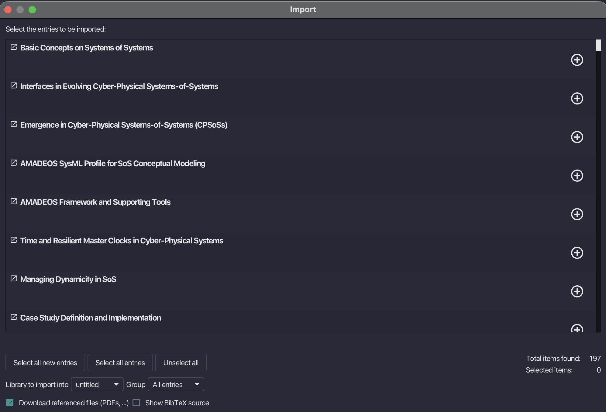
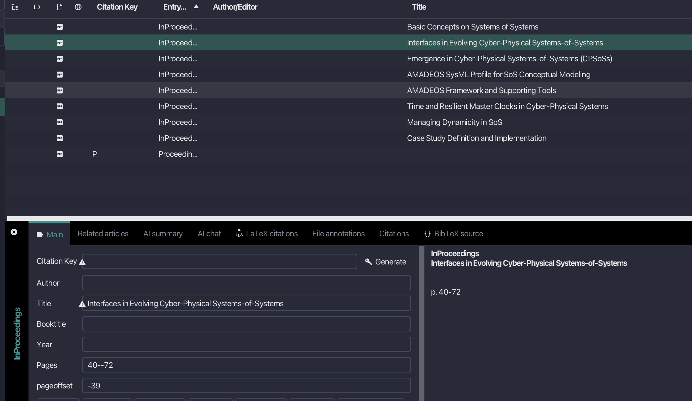
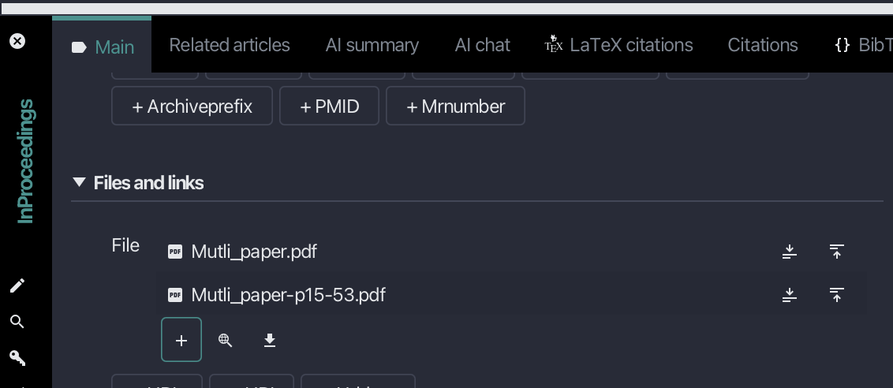
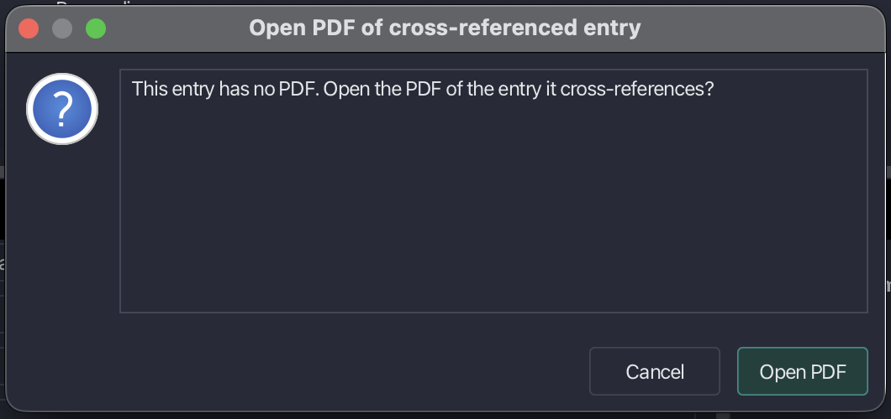
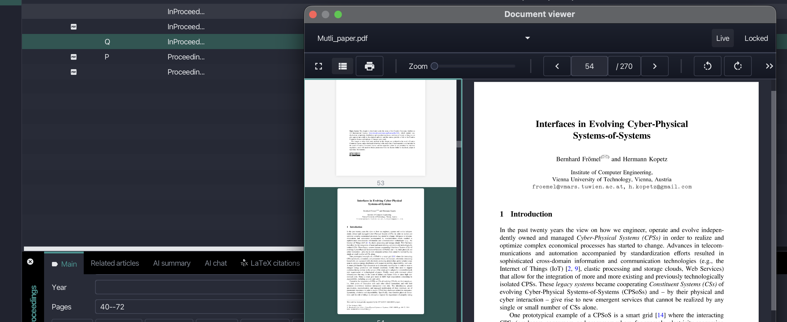
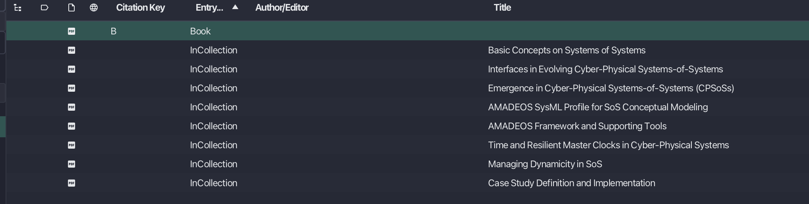

# Multi-paper PDFs

Conference proceedings, edited collections, and some books come as a single PDF that contains several papers or chapters. JabRef recognizes such a PDF and, if you agree, creates one entry for each paper. Each paper gets a PDF containing only its pages and keeps the page numbers printed in the volume. The original PDF is never changed.

## Importing a multi-paper PDF

You can import a multi-paper PDF in three ways:

* **File → Import into current library...** or **File → Import into new library...** and select the PDF.
* **Lookup → Search for unlinked local files**, see [Add entry using PDFs](findunlinkedfiles.md#adding-files-currently-not-linked-in-the-library).
* Drag and drop the PDF between two entries of the entry table, or onto its empty area.

Before it creates any entry, JabRef asks, for example, "proceedings.pdf contains 8 papers. Split it into one PDF per paper? Each PDF is linked to its paper's entry, and missing entries are created. The original PDF is kept."

* **Split PDF** creates the entries described below.
* **Import as one entry** imports the PDF like any other PDF, as a single entry. In **File → Import**, the references cited in the PDF are listed after it, as described below for Grobid.

If you choose **Split PDF** in **File → Import**, the [import inspection window](import/importinspectiondialog.md) lists the papers first, followed by the entry for the whole PDF. If sending PDFs to Grobid is allowed (**File → Preferences → Web search**, section "Remote services"), the references cited by the papers are listed after them. Grobid may not answer in time for a large PDF. In that case, only the papers and the entry for the whole PDF are listed. When you import the selected entries, JabRef splits the PDF without asking again. With **Import into new library...**, there is no inspection window: JabRef opens a new library with these entries and splits the PDF.

With **Search for unlinked local files**, the result reads, for example, "File was imported as 8 papers and an entry for the whole PDF".

<figure><figcaption>
File → Import lists the papers first
</figcaption></figure>

After you choose **Split PDF**, JabRef creates the following entries:

| Entry | Type | Content |
| --- | --- | --- |
| One entry for the whole PDF | Proceedings, Collection, or Book | Citation key from the file name, title, the original PDF, and `pageoffset` |
| One entry per paper | InProceedings, InCollection, or InBook | Title, printed pages (for example `40--72`), `crossref` to the entry for the whole PDF, `pageoffset`, and a PDF containing only the paper's pages |

The PDFs of the papers are named after the paper titles and saved next to the original PDF. The entry for the whole PDF keeps its citation key, even if **Generate new keys for imported entries (overwriting their default)** is enabled in **File → Preferences → Citation key generator**, so that the `crossref` of the papers keeps working. If the library already has an entry with that key, for example because you import the same PDF twice, the new entry gets the key with a suffix such as `a`, and its papers cross-reference that key. If the import finds the entry for the whole PDF to be a duplicate, the papers follow your choice: they cross-reference the existing entry if you keep it, or the merged entry if you merge the two.

The type of the entry for the whole PDF follows the PDF's front matter:

* **Proceedings** if the title pages or bookmarks name a conference, workshop, or symposium, or list the committees that organized it.
* **Collection** if they name editors, for example "(Eds.)" or "Edited by", list the contributors, or if the papers give the e-mail addresses of their authors.
* **Book** otherwise.

## Splitting a PDF attached to an existing entry

Attach a PDF to an entry using the **+** button in the **Files and links** section of the [entry editor](../advanced/entryeditor/), or using **More file operations... → Attach file** in the context menu of the entry table. What happens next depends on the entry:

* **Proceedings, Collection, or Book entry** (and their multi-volume types): if the PDF contains several papers, JabRef asks, for example, "proceedings.pdf contains 8 papers. Split it into one PDF per paper?". Click **Split PDF** to split it. JabRef then reports, for example, "Created 8 entries from the PDF." Each new paper cross-references the entry if it has a citation key. A paper that already cross-references the entry under the same title gets its PDF instead of a second entry, unless it already has a PDF. The entry stores the `pageoffset` of the PDF if it has none. Click **Cancel** to only attach the PDF.
* **Any other entry with `pages`**: if the PDF contains more than these pages, JabRef asks, for example, "Copy pages 15 to 53 of proceedings.pdf into a new PDF for this entry? The original PDF is kept." Click **Copy pages** to add a copy of just these pages, for example `proceedings-p15-53.pdf`, next to the original PDF. If the entry has no `pageoffset`, the one of the entry it cross-references is used. If the PDF already contains only these pages, JabRef does not ask and makes no copy.

<figure><figcaption>
Attaching the PDF to the proceedings entry P creates one entry per paper, each with its printed pages and its own pageoffset
</figcaption></figure>

<figure><figcaption>
Attaching the PDF to an entry with the pages 15--53 adds a copy of just these pages
</figcaption></figure>

### Splitting a PDF that is already attached

To split a PDF that is already attached to a Proceedings, Collection, or Book entry, right-click the PDF in the **Files and links** section of the entry editor and choose **Split PDF**. JabRef asks as described above. If the PDF does not contain several papers, JabRef reports, for example, "No separate papers were found in proceedings.pdf." Papers that already have a PDF are left out, so splitting the same PDF again does not add a second copy. If all papers have one, JabRef reports, for example, "All papers in proceedings.pdf already have a PDF." For other entry types, and for files that are not PDFs or cannot be found, **Split PDF** is unavailable.

Splitting is a single step that you can take back with **Edit → Undo**. Undo also moves the PDFs of the papers out of their folder, and **Edit → Redo** puts them back. A PDF that was changed or moved after the split stays where it is.

## Opening a paper at its first page

**View → Open document viewer** opens the PDF of the selected entry at the first page given in `pages`, shifted by `pageoffset`. Entries without `pages`, such as the entry for the whole PDF, open at the first page of their PDF. So does a PDF that holds only the entry's pages, such as an article PDF or a copy of the pages made by JabRef, when no `pageoffset` is set.

If the entry has no PDF but cross-references an entry that has one, JabRef asks "This entry has no PDF. Open the PDF of the entry it cross-references?". Click **Open PDF** to open that PDF at the entry's first page.

<figure><figcaption>
JabRef asks before opening the PDF of the cross-referenced entry
</figcaption></figure>

<figure><figcaption>
The entry Q with the pages 40--72 and the crossref P opens the PDF of P at page 54
</figcaption></figure>

## The pageoffset field

Printed page numbers and PDF page numbers often differ, because front matter such as the preface and the table of contents comes before printed page 1. The field `pageoffset` stores the difference, PDF page minus printed page, for the PDF linked to the entry. For example, if printed page 1 is the 15th page of the PDF, the offset is `14`, and printed page 40 opens at PDF page 54, as shown in [Opening a paper at its first page](#opening-a-paper-at-its-first-page).

JabRef reads the offset from the PDF's page labels when it imports or splits a PDF. The PDF of a paper starts at the paper's first page, so its offset is negative: a paper on pages `40--72` has the offset `-39`, and its PDF opens at page 1. Without `pageoffset`, printed pages and PDF pages are taken to be the same, unless the PDF has no more pages than the range in `pages`. Such a PDF holds only the entry, so it opens at page 1.

You can also set `pageoffset` yourself, for example in the [BibTeX source tab](../advanced/entryeditor/add-entry-manually.md), when a PDF has no page labels. An offset that is already set is used when the PDF is split.

## Which PDFs are recognized

JabRef finds the papers using the bookmarks (outline) of the PDF. A PDF counts as a multi-paper PDF only if:

* its bookmarks list at least two papers,
* most papers start on a page with a title set larger than the text, and
* if the papers have bookmarked sections, most of them share a section name such as "Introduction" or "References".

Bookmarks without sections next to papers with sections, such as the preface or the author index, do not get entries. A PDF without bookmarks, or with a single paper, is imported or attached as usual, without the question.

## BibTeX and biblatex libraries

In a biblatex library, the entry types are as described above. BibTeX has no collection type and passes on only fields of the same name through `crossref`. Thus, in a BibTeX library:

* an imported collection becomes a Book,
* the entry for the whole PDF repeats its title as `booktitle`, and
* papers in a book are InCollection entries, because the title of a BibTeX InBook entry is the title of the book.

<figure><figcaption>
In a BibTeX library, attaching the PDF to the Book entry B creates InCollection entries
</figcaption></figure>

See [BibTeX and biblatex](../cite/bibtex-and-biblatex.md) for the differences between both modes.
